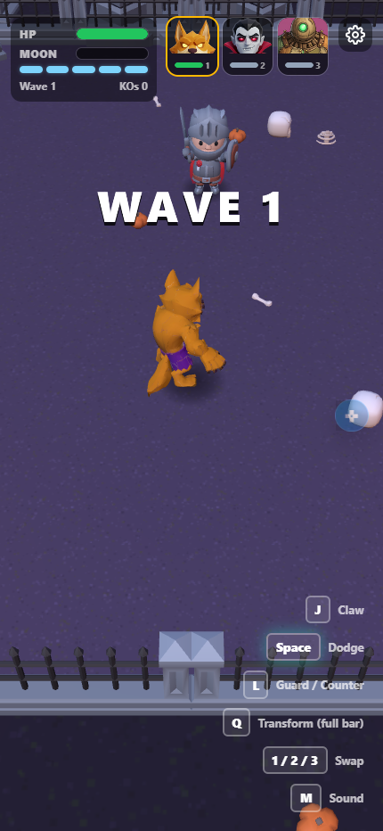

# Tag Team Terror

A 3D monster tag-team brawler for the [RUN October Jam](https://run.world/jams/octoberjam) (theme: Monster Mash). Swap between the Werewolf, the Vampire and the Stitched to fight off waves of monster hunters, then face the Gravelord every five waves.



## How to play

| Action | Keyboard | Phone |
| --- | --- | --- |
| Move | WASD | Joystick |
| Claw (3-hit combo) | J or click | CLAW |
| Special (cooldown) | E | SPECIAL |
| Dodge | Space or K | DODGE |
| Guard / counter | L or right-click (hold to block) | GUARD |
| Transform (full bar) | Q | TRNS |
| Swap monster | 1, 2, 3 | Tap a portrait |

- **Red** attacks: dodge them. Dodging at the last moment starts the Witching Hour (enemies slow down).
- **Purple** attacks: guard just as they land to counter.
- **Special**: E (or SPECIAL) fires the monster's special, then it recharges.
- **Full bar**: press Q (or TRNS) to transform for 10 seconds. Only transforming spends the bar.

## Features

- Three monsters with their own move sets, specials and transformations, plus tag-team combos (Crimson Rain, Lightning Rod).
- Knights, barbarians, crossbow rogues and mages, getting stronger every wave.
- The Gravelord boss: hyper armor, a phase 2 at half health (roar, summons, Grave Leap) and a big payoff when it falls.
- Hunters raise blue shields now and then: break them with a finisher or a special, or hit from behind.
- Four realms: every boss opens a portal to the next map.
- PVP Arena: fight another player's saved tag team (their monsters, in their skins, played by the AI), using RUN's async PVP.
- Daily Hunt leaderboard and streak, challenge links to beat a friend's wave, and a skin shop (Souls earned in runs, RUN Bits, or an all-skins bundle).

## Trailer

`trailer/` is a Remotion project that captures gameplay from the game and renders a 32-second promo in 16:9 and 9:16. See `trailer/README.md`.

## Run it locally

Needs Node.js 18+ and the [RUN CLI](https://github.com/series-ai/rundot-cli-releases) (`rundot`).

```bash
npm install
npm run dev                    # http://localhost:5173 (asks for a RUN sign-in: playground backend)
NO_PLAYGROUND=1 npm run dev    # plain browser, no sign-in, RUN features mocked
```

Add `?beat=7&from=Jo` to the URL to try the challenge flow locally.

## Deploy

```bash
npm run build
rundot deploy    # private by default; uploads rundot/shop.config.json too
```

## Project notes

- `CLAUDE.md`: how the code is organized (simulation in `src/game/`, three.js view in `src/game/view/`, UI in `src/ui/`, RUN SDK features in `src/sdk/`).
- `docs/spec-and-build-plan.md`: design, roadmap and status.
- `docs/sound-credits.md`: CC0 sound sources.
