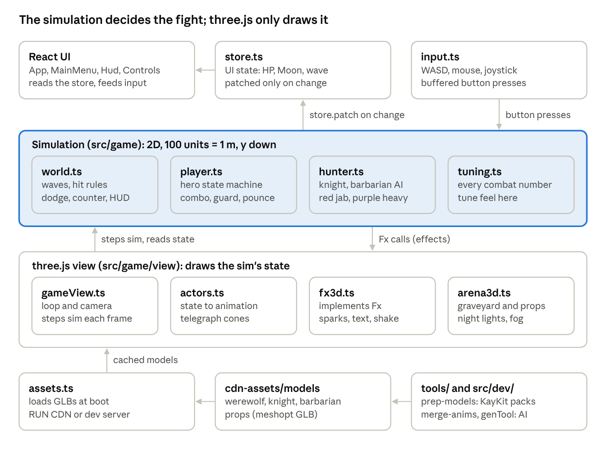
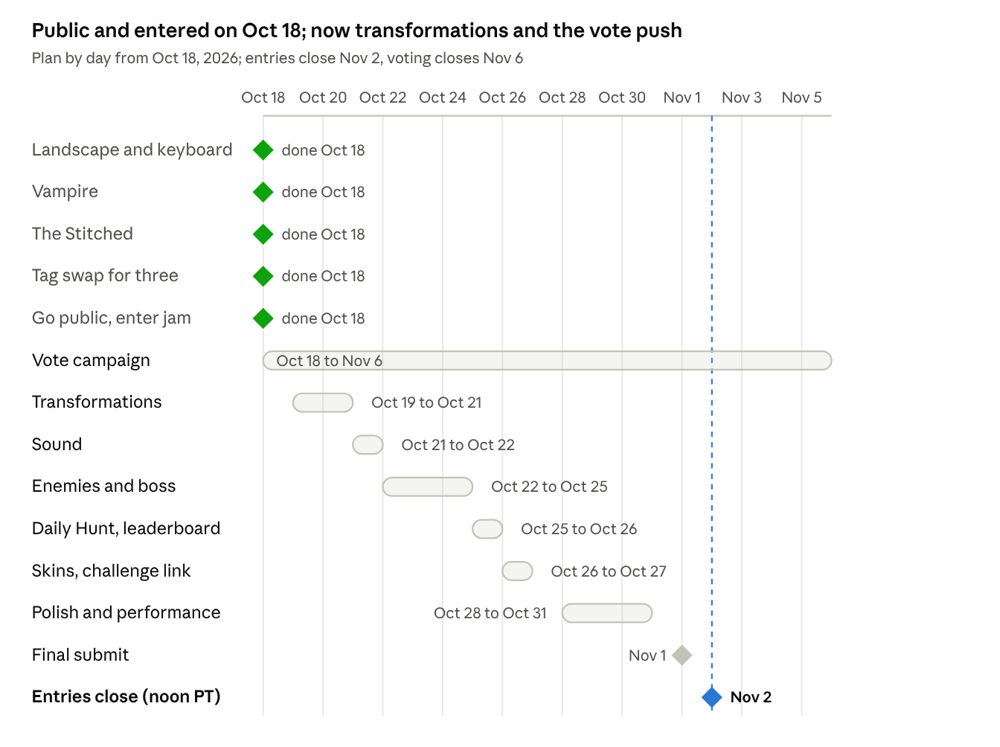

# Tag Team Terror: Spec and Build Plan

Oct 18, 2026 (updated Oct 21) · Josephine Kemigisha

Live, editable version: https://claude.ai/code/artifact/ffc7bb84-0ca3-46dd-b08d-8145669470d3

## Summary

Tag Team Terror is a 3D monster tag-team brawler for the RUN.world October Jam (theme: Monster Mash), due **Nov 2, 2026 at 12:00 PM Pacific (11:00 PM in Uganda)**. The game is public and **entered in the jam** (Oct 18); the live build is **v1.5.0** (Oct 18), with all three monsters (the Werewolf, the Vampire and the Stitched) and full tag swapping, the hold-to-block guard, a special and a transformation per monster, and ranged hunters in waves that get harder, on phones (portrait, touch) and PC (landscape, keyboard and mouse). The goal is to win on both fronts: the community vote prizes and the $15,000 Editor's Pick.

Still to build: the shield knight and a boss, techniques (E), a Daily Hunt leaderboard and a skin shop. Built locally but not deployed yet: the full sound pass (effects, monster voices, announcer, music and ambience, all CC0), an end-screen vote prompt with a Share button, and the Stitched fixes from the phone test. On the evening of Oct 18, `rundot jam promo` showed the entry at rank #190 with 3 votes and 30 plays.

**Oct 21:** the boss fight, the fence fix, the friend challenge, the skin shop and realms (a portal after every boss) are built and tested in the browser on the GitHub branch `claude/fight-polish` ([buhamzok/game-jam](https://github.com/buhamzok/game-jam)). None of it is deployed yet.

**Next session: `claude/fight-polish` is merged into `main` (Oct 21): `git pull` on the PC, play it on a phone and a PC (boss phase 2, guards, the SPECIAL button, portals, levels and upgrades, blood, the skin shop and the PVP Arena in the playground), then `npm run build` and `rundot deploy` (owner's call). The deploy also uploads `rundot/shop.config.json` and `rundot/simulation/pvp-system.json`. Post the trailer (`trailer/out/`) with the vote link.**

- Project folder: `D:\PROJECTS2\tag-team-terror` (GitHub: [buhamzok/game-jam](https://github.com/buhamzok/game-jam))
- RUN game ID: `Zo8tRIGBpGhAGb0XCXoI` (public; builds 1.0.0 to 1.5.0; entered in the October Jam)
- Public link: [play the latest build](https://w.run/cobaltphoenix373/tag-team-terror)
- Credits: 104,066 (the 100,000 jam bonus arrived)
- Combat inspiration: Bleach: Soul Resonance mechanics only, with original characters and names

## Jam rules that shape the build

The game must be original, built and first published after Oct 8, published to public, and entered through **Enter the jam** in the RUN Creator Hub before the deadline. Publishing alone does not enter it.

| Rule or fact | What it means for us |
| --- | --- |
| Entries close Nov 2, 12:00 PM PT; voting and judging close Nov 6 | Publish early: votes count from Oct 15, and updates after publishing keep the entry and its votes |
| No 1:1 clones, no copyrighted names or art | Never use Bleach names or terms (Bankai, Zanpakuto, Getsuga, Soul Reaper, Hollow). Mechanics are fine |
| Games built in Game Studio, Adventure Studio or the rundot CLI | We use the rundot CLI with Claude, which the jam page allows |
| $22,000 of $30,000 goes to Editor's Picks (top $15,000) | Polish and combat feel matter most |
| Game community votes: $2,000 / $1,200 / $800 | Share the link (Discord, X, WhatsApp) with a short trailer |
| Special awards, $500 each | Most Sticky (Daily Hunt), Best Monetization (cosmetic skins), Best Social Features (challenge a friend), Best Use of Theme (monster transformations) |
| Entrants get 100,000 free credits | Received; balance now 104,066 credits |
| Payout through Tipalti in USD; winners sign a declaration within 7 days | Use a USD bank account at a Ugandan bank that accepts SWIFT wires; up to 30% US withholding may apply (no US tax treaty with Uganda) |

Sources: [official rules](https://policy.run.world/octoberjam-rules.html), [participant guide](https://events.run.world/events/octoberjam/).

## How we win

We go for both fronts: about 250 votes for a top-3 vote prize, and enough polish and RUN features for the $15,000 Editor's Pick. On Oct 18 the game leaderboard read 237 votes (Boneyard Boogie, 1,490 plays), then 120 and 113; our entry had 14 plays and 2 votes.

| Front | What decides it | Our moves |
| --- | --- | --- |
| Community votes ($2,000 / $1,200 / $800) | The **Vote** button on the jam page; one vote per person per entry, Oct 15 to Nov 6; likes elsewhere on RUN do not count | Public and entered Oct 18 (v1.3.0); rally our own network (WhatsApp and campus groups, X, RUN Discord) with the jam link and "press Vote"; `rundot jam promo` for links and captions; an end-screen line "Enjoyed it? Vote on the jam page"; a 15 s trailer, then short progress clips every few days |
| Editor's Picks ($15,000 to $800) | RUN's team, independent of votes; criteria not published | Combat feel (sound first), the full three-monster tag team, transformations with cut-ins, RUN features (leaderboard, Daily Hunt, shop, sharing), smooth on phones and PC |
| Special awards ($500 each) | RUN's team | Daily Hunt (Most Sticky), cosmetic skins (Best Monetization), challenge link (Best Social Features), transformations (Best Use of Theme) |

Vote math from the leaderboard: the leader converts about 1 in 6 plays into votes, while 2nd and 3rd have about as many votes as plays, so they are pulling votes from their own circle. We need both: a fast first 10 seconds for strangers in the RUN feed, and a personal push to people we know.

Never: trade votes ("I vote yours, you vote mine"), reward votes, or use extra accounts. The rules disqualify the entry for any of these.

## Current state

Three monsters fight as a full tag team in 3D on phones and PC. v1.3.0 went public and into the jam on Oct 18; v1.4.0 added the guard, transformations and move sets, and v1.5.0 (public the same day) added ranged hunters, harder waves and new specials. Rows marked "not re-tested" still need a hands-on check.

| Area | Built | Verified |
| --- | --- | --- |
| Heroes | Werewolf (amber), Vampire (crimson) and Stitched (electric green): AI-generated models, each with its own 12-clip move set (see Monster move sets) | Werewolf fully tested; Vampire and Stitched frame-stepped in the browser (swaps, specials, Lightning Rod) |
| Tag swap | Keys 1, 2 and 3, or tap a HUD portrait; arriving monster spins (entry attack); 2 s cooldown; benched monsters refill energy; the Vampire's bats hit from the bench; **Crimson Rain** backline strike if her portrait is pressed within 2 s of a teammate's big move; swapping out of a living Stitched leaves **Lightning Rod** (+25% damage for 10 s); when the active monster falls the next one comes in | Browser tests pass for all three monsters; not re-tested on a phone |
| Combat | 3-hit combo with aim assist, dodge, perfect dodge (Witching Hour: enemies at 12% speed for 1.5 s, 8 s cooldown), guard (tap: 0.22 s parry window; hold: blocks up to 5 hits, then a 2 s guard break), counter on purple attacks, a special per monster when the energy bar is full (Moon Pounce, Swarm Slam, Thunder Smash), and a transformation on Q (10 s, +35% damage) | Frame-stepped tests in the browser; guard, transformations and the new specials tested Oct 18 |
| Enemies | Knight (sword and shield), Barbarian (axe, from wave 2), crossbow Rogue (from wave 3) and Mage (from wave 5); red jab and armored purple heavy; poise break stun; 2 attacking at once, rising to 4 in later waves | Seen in screenshots; Rogue and Mage tested in the browser (bolts, blocks, parries, circles) |
| Waves | Wave n spawns 2 + (n - 1) hunters, capped at 7; endless; every wave makes hunters tougher, harder-hitting, faster and quicker to attack | Yes |
| 3D view | three.js, 3/4 top-down camera, graveyard props, night lighting, blob shadows, hit flash, particles, slash arcs, rings, floating text, screen shake, hitstop | Desktop: about 54 draw calls, 23k triangles |
| Controls | Phones: portrait, touch joystick and buttons. PC: landscape, keyboard and mouse with on-screen key hints | Type check passes; PC not re-tested |
| RUN | Builds 1.0.0 to 1.5.0; public and entered in the jam since 1.3.0 (14 plays, 2 votes on Oct 18); 1.5.0 is the live build; orientation both, offered on phones and PC; thumbnail; local playground | Prod smoke test passed; listed on the jam page; 1.5.0 checked on the public link |

Not built yet (as of Oct 18): music, shield knight, boss, techniques (E), Daily Hunt, leaderboard, skin shop, trailer. The boss, Daily Hunt, leaderboard, sound and skin shop have since been built; see "Built Oct 21".

**Fixed after the phone test** (Oct 18, not deployed yet): five Stitched clips (finisher slam, dodge, counter, hit, death) from the second animation batch had never been downloaded, so his finisher and his smash replayed his first punch. They are merged now, and every Stitched attack clip is timed from its measured hit frame, so the blow lands the moment the game registers it. His speed is 320 with the walk cycle at 3.4x, so his feet no longer slide. The Werewolf and the Vampire have the same gap (their dodge, counter or hit, death and finisher are still first-batch clips): they play fine, but those are not their intended moves.

## Built Oct 21 (branch claude/fight-polish, not deployed yet)

Tested in a headless browser: type check, production build, frame-stepped scenarios and a random-input bot that played from wave 1 to wave 14, through two boss fights and two portals, with no errors. Not yet played on a phone.

| Area | What changed |
| --- | --- |
| Gravelord boss | Hyper armor: normal hits never interrupt it; only a poise break stuns it. Its body radius (92) now matches the 3.2 m model, so monsters no longer stand inside it. At half HP it roars into phase 2: immune for 1.5 s, pushes the player back, raises a knight and a barbarian, attacks 18% faster with shorter cooldowns, quakes every second attack with a wider circle, and adds the **Grave Leap** (it jumps onto a red circle under a player who keeps their distance; dodge out). Its death: slow motion, every hunter left crumbles (KOs still count), the team heals 35% and refills energy, "GRAVELORD FALLS". The boss bar shows a notch at 50% and "ENRAGED". |
| Fight feel | "WAVE CLEAR" or "FLAWLESS" callout when a wave ends. |
| Fence clipping | Bodies stop 38 units inside the fence on the sides and far end, 90 at the near fence, so no monster or hunter stands in the railings. |
| Challenge a friend (Best Social Features) | End screen: "Challenge a friend: beat wave N" shares a RUN link with the wave, KOs and the player's name; the RUN app's own Share button sends the same challenge after a run. Opening the link shows a challenge card on the menu (ACCEPT), a target line in the HUD, a "CHALLENGE BEATEN" banner when passed, and "Challenge back" on the end screen. Read at launch with `app.resolveLaunchIntent()`. |
| Skin shop (Best Monetization) | Two recolors per monster (Silverback, Hellhound, Nosferatu, Blood Moon, Pumpkin King, Toxic) plus a faint aura; looks only. Unlock with Souls (earned every run: 1 per KO, 5 per wave, 25 per Gravelord), with RUN Bits (50 or 100), or all six for $0.99 (`tier_099`). Shop items in `rundot/shop.config.json`; ownership from RUN entitlements. SKINS button on the menu. |
| Realms (levels) | A portal opens when the Gravelord falls; waves wait until the player steps in. Four realms in a cycle: the Graveyard, the Hollow Woods (1500 x 2000, dead trees), the Pumpkin Patch (giant jack-o'-lanterns, lantern light) and the Blood Moon Crypt (gravestones and a coffin). Each has its own size, ground, fog, lights and border; obstacles are solid and stop bolts (cover). Waves keep counting and getting harder; after the crypt the cycle repeats ("The Graveyard II"). |
| Repo | Screenshots moved to `docs/screenshots/`, browser test logs removed, README describes the game. `NO_PLAYGROUND=1 npm run dev` runs without the RUN sign-in (headless tests). |

To check on a phone: the Grave Leap circle is readable, the boss is beatable at wave 5, the Hollow Woods trees do not hide the action, and the frame rate holds in the Pumpkin Patch (six point lights).

## Built Oct 21, part 2 (same branch, not deployed yet)

Tested the same way (browser scenarios, a bot through two bosses and two portals, a full PVP match). Not yet played on a phone.

| Area | What changed |
| --- | --- |
| Phantom damage bug | The benched Vampire hit a random hunter for 6 every 2.2 s, anywhere on the map: hunters lost HP with nothing visibly hitting them. Removed (Crimson Rain stays). |
| Special vs transform | Mashing claw no longer fires the special and empties the bar. Specials moved to their own button (E / SPECIAL) with a cooldown (9, 10, 11 s); only Q / TRNS spends the bar. |
| Hunters guard | Knights, barbarians and the enraged Gravelord raise a blue shield now and then in answer to a swing (from wave 2): frontal hits are blocked; finishers, specials, counters and shocks break it (stun, extra damage), and so do 4 blocked hits or a hit from behind. Numbers in `T.hunter.guard`. |
| Full Moon wolf | Glowing red eyes on the head bone, grown in with the transformation (`src/game/view/wolfForm.ts`). Silver claws were tried and removed (part 3). |
| The Stitched | Calm idle (his idle clip opened with a turn-away and an overhead flex), natural follow-through after each punch, smoother returns to idle. |
| Title screen | Live 3D lineup of the three monsters (equipped skins show), bigger FIGHT, PVP ARENA, SKINS, HOW TO PLAY panel, compact Daily Hunt card. |
| PVP Arena | RUN async PVP: after every hunt the team (monsters, skins, power from the best wave) is saved; the arena finds another player's team (or a labelled bot) and the AI plays it in the Blood Pit, one monster at a time, with tag-outs. Win +40 Souls, lose +10; results go through the server check (`rundot/simulation/pvp-system.json`). |
| Trailer | `trailer/` (Remotion): gameplay captured from the game, 32 s promo on a 180 BPM grid with motion graphics, in 16:9 and 9:16. Video skills (remotion, motion-graphics) installed in `.claude/skills/`. |

## Built Oct 21, part 3 (same branch, not deployed yet)

| Area | What changed |
| --- | --- |
| Blood | Hits on hunters spray a few dark-red droplets out the far side (more for heavier hits; bites and auras under 5 damage stay clean). Some land as splats that fade after 9 s (45 at most); a kill sprays more and leaves a pool. Cleared on each new realm. `Fx.blood`, `T.gore`, `GORE` in `fx3d.ts`. |
| Levels and stats | Player level 1 to 30 from XP: 4 per KO, 10 + 2 x wave per cleared wave, 60 per Gravelord, 50 x realm number per portal, 60 / 20 per PVP win / loss; kill and wave XP pay 25% more per realm tier. XP per level climbs faster the higher you go (50 + 12 x level^1.7): level 2 takes 60 XP, level 11 650, level 21 about 2,000, level 30 3,725 (42,775 in all; about 5 good runs to level 10, 25 to level 20, 60 to level 30). Each level gives 2 points for five stats (12 points max each, 58 points in all): Vitality +4% HP, Strength +3% damage, Agility +1.5% speed, Fury +5% transform bar gain, Focus -3% special cooldown. Boosts apply to the whole team in the hunt and PVP; RESET is free. UPGRADES screen from the menu's level card and the end screens; LEVEL N callout mid-run. PVP power now counts the level. `src/game/progression.ts`, `src/sdk/progress.ts`, `src/ui/Upgrades.tsx`. |
| Harder realms | Each realm adds a danger tier on top of the wave scaling: +30% hunter HP, +15% damage, +3% speed, -5% attack cooldowns and one more hunter per tier (up to +2, for phone frame rates). The realm banner shows the danger level. `T.realmTier`. |
| HUD fix | The HP bar's maximum was stuck at 100 (the Stitched's bar overflowed); it now follows the active monster's max HP. |
| Bodies | Characters no longer stand inside each other: each has a body size matched to its model (Werewolf 46, Vampire 40, Stitched 58, hunters 40, Gravelord 104; the hit radius stays smaller), crowds settle over three push passes, heavier bodies move less (the Gravelord barely), and melee hunters stop at body contact. Dodges, counters and specials still pass through. `T.bodies`. In a crowd test bodies never overlapped by more than 5%. |
| Ten realms | Six new maps, for ten in a cycle: Graveyard, Hollow Woods, Pumpkin Patch, **Autumn Hollow** (orange pines, fallen-leaf floor), **Shrine Road** (long stone road, skull posts, shrines), Blood Moon Crypt, **Ossuary** (bone barriers, columns, green light), **Dungeon Depths** (stone tiles, walls, torches, six pillars), **Hunters' Keep** (their hall: banners, barrels, columns) and **Witching Gate** (a stone circle under a violet sky, the last before the cycle repeats). New floor patterns (leaves, tiles), five new border styles, a stone road, torch and shrine lights. Extra props from KayKit Halloween Bits and Dungeon Remastered (CC0, cloned from GitHub); props.glb grew from 219 KB to 468 KB (the heaviest decorated props were left out). |
| Health potion | Each portal has a 50% chance of a red potion a few steps in front of it; walking over it heals every monster still standing by 30% of its max HP. Left behind if you step through first. `T.potion`, `view/potion3d.ts`. |
| Thumbnail | New 512 x 512 tile: the Full Moon wolf (red eyes), the Vampire and the Stitched in the graveyard under a blood moon, with the trailer's title type. Rebuild: `?tool=thumb` (dev only) plus the `Thumbnail` composition in `trailer/`. |

## Architecture

Game rules never touch three.js: to add a monster or an enemy, change the simulation first, then give it a view in `actors.ts`. Every file is listed with its job in `CLAUDE.md` in the project folder.

## Done: the Stitched (v1.3.0, Oct 18)

The third monster completes the tag team the title promises. What shipped:

1. **Concept:** regenerated with safer wording after Meshy's content checker rejected the first attempt because of body-part phrasing; `art/stitched-concept.png` (a patchwork scarecrow golem with glowing green seams). 120 credits.
2. **Mesh:** Meshy image-to-3d on the new concept, 12,000 polygons (about 1,800 credits), saved as `art/stitched-mesh.glb`.
3. **Clips:** a `stitched` job in `src/dev/genTool.ts` with the same 10 clip IDs as the other monsters (89, 14, 193, 195, 214, 158, 90, 382, 178, 8); clips in `art/stitched-anims/`.
4. **Merge:** `node tools/merge-anims.mjs public/cdn-assets/models/stitched.glb idle=... run=... ...` gives a 968 KB model with all 10 clips.
5. **Game:** `stitched` in `src/game/view/assets.ts` (optional model), third roster slot, key 3 (`swap2`), third HUD portrait "S".
6. **Kit:** slow heavy hits in `tuning.ts` (hp 135, speed 365, 14 / 14 / 28 damage, a half-second Thunder Slam with radius 220); **Lightning Rod**: swapping out of a living Stitched leaves a +25% damage buff for 10 s on whoever comes in next (`src/game/world.ts`); transformation **Overcharge** comes with milestone 5.

Verified in the browser with `window.__ttt`: three-monster team and swaps, entry spin, auto-tag on death, rod buff math (a 14-damage swing lands 17.5), and Thunder Slam. A prod smoke test on RUN.world passed, then `rundot deploy --public -o Both --platform-fit Both --bump Minor` shipped v1.3.0, and the owner entered it in the jam the same day.

### Controls

| Action | PC | Phone |
| --- | --- | --- |
| Move | W A S D or arrows | Left-thumb joystick |
| Claw | J or left click | CLAW button |
| Special (cooldown) | E | SPECIAL button |
| Dodge | Space, K or Shift | DODGE button |
| Guard and counter | L or right click (tap: parry; hold: block) | GUARD button (tap or hold) |
| Swap monster, Crimson Rain | 1, 2, 3 | Tap a portrait |
| Start fight, retry | Enter (or Space on the menu) | FIGHT, Try again |
| Back to menu | Esc | Menu button |
| Transform (full bar) | Q | TRNS button |

## Done: hold-to-block guard and monster move sets (v1.4.0)

Two changes make the three monsters feel different and give defense more depth: a guard you can hold, and a move set that fits each monster. Both shipped in v1.4.0 on Oct 18.

### Hold-to-block guard

- **Tap GUARD** (L, right click or the GUARD button): unchanged. The first 0.22 s is the parry window, and a purple attack inside it triggers a counter.
- **Hold GUARD:** the guard stays up as long as the button is held. Every hit taken while guarding is blocked (no damage).
- **5 hits:** the guard absorbs up to 5 hits. The 5th hit **breaks** it.
- **Guard break:** the guard cannot be raised again for **2 s** (cooldown). Show it with a shatter ring, "GUARD BREAK" text, and a dimmed GUARD button with a cooldown ring.
- **HUD:** 5 small shield pips near the HP bar, one cracking per blocked hit.
- **Tuning** (`src/game/tuning.ts`): `guard: { parryWindow: 0.22, maxHits: 5, breakCooldown: 2 }`. Same for all three monsters.
- **As built:** the pips reset each time the guard is raised; no stagger on a guard break; no walking while guarding; a dodge does not cancel the guard. Change any of these after the phone test (`src/game/player.ts`, `src/game/tuning.ts`).
- **Done when:** holding guard blocks 5 hits on phone and PC, the 5th breaks it, and guard is unusable for exactly 2 s after.

### Monster move sets

Each monster now has its own set from the [Meshy animation library](https://docs.meshy.ai/en/api/animation-library), chosen to fit what it is: the Werewolf feral and fast, the Vampire elegant and magic, the Stitched heavy and slow.

| Move | Werewolf (feral, fast) | Vampire (elegant, magic) | Stitched (heavy tank) |
| --- | --- | --- | --- |
| Idle | 89 Combat_Stance | 11 Idle_02 | 12 Idle_03 |
| Run | 509 Lean_Forward_Sprint | 15 Run_03 | 112 Monster_Walk, played faster |
| Combo 1 | 193 Left_Hook (claw swipe) | 97 Left_Slash | 214 Punch_Forward_with_Both_Fists |
| Combo 2 | 195 Right_Upper_Hook | 219 Right_Hand_Sword_Slash | 128 Heavy_Hammer_Swing |
| Finisher | 457 Jumping_Punch | 221 Charged_Upward_Slash | 127 Charged_Ground_Slam |
| Dodge | 384 Quick_Step_and_Spin_Dodge | 452 Backflip | 156 Stand_Dodge (sidestep) |
| Guard (hold, loops) | 139 Block2 | 147 Sword_Parry | 138 Block1 |
| Counter | 93 Dodge_and_Counter | 90 Counterstrike | 220 Shield_Push_Left (shove) |
| Special | 382 Jump_and_Slam (Moon Pounce) | Bats in flight, then 221 Charged_Upward_Slash to re-form (Swarm Slam, v1.5.0) | 127 Charged_Ground_Slam (Thunder Smash, v1.5.0) |
| Hit (also guard break) | 178 Hit_Reaction | 179 Hit_Reaction_1 | 171 Hit_Reaction_to_Waist |
| Death | 189 dying_backwards | 185 Shot_and_Slow_Fall_Backward | 187 Knock_Down |
| Transformation | 88 Chest_Pound_Taunt (roar) | 397 360_Power_Spin_Jump | 255 Angry_Ground_Stomp |

- **Generation:** 12 clips per monster, so 2 requests each (RUN allows 10 per request), 6 in total through `src/dev/genTool.ts`. The last runs were not billed; if they are, the quote is about 2,300 credits per monster, about 7,000 for all three.
- **Code:** a separate clip map per monster in `src/game/view/actors.ts`; new slots for guard (looping), transformation and cast; each attack's playback speed tuned so the visible hit lands when the simulation registers it.
- **Check:** the moves were picked by library name only. Preview each clip and swap any that look wrong; a replacement request is cheap.
- **Done when:** all three monsters play their own set in game, and each combo hit visibly connects on its active frame.

## Done: ranged hunters, harder waves, new specials (v1.5.0, Oct 18)

Built and tested in the browser (type check, production build, frame-stepped tests, and a random-input run to wave 5 with no errors), then deployed publicly as v1.5.0 on Oct 18 and checked on the public link. Not yet played on a phone.

### Ranged hunters

- **Crossbow Rogue** (from wave 3): keeps 360 to 560 units away and backs off when a monster closes in. It aims along a red line that goes solid when the aim locks, then fires a bolt. Dodge it (dodging at the last moment triggers Witching Hour), block it with a held guard (one pip), or parry it in the window to send it back for 30 damage. Hitting a rogue while it aims interrupts the shot.
- **Mage** (from wave 5): marks a purple circle under the active monster. The circle follows for the first 60% of the cast, then stays put: step out before it bursts. Its cast is armored, and a parry in the window warps the monster to the mage for a counter.
- Both come from the free KayKit Adventurers pack (Rogue_Hooded and Mage), built by `tools/prep-models.mjs` (`ONLY=rogue,mage` rebuilds just these two).

### Waves get harder

- Each wave after the first adds 10% hunter HP (up to 2.2x), 6% damage (up to 1.8x) and 3% speed (up to 1.3x), and cuts windups by 3% (down to 0.7x) and attack cooldowns by 5% (down to 0.55x).
- One more hunter may attack at once every 4 waves: 2 at the start, 3 from wave 5, 4 from wave 9.
- Roster: knights; barbarians from wave 2; 1 rogue from wave 3 and 2 from wave 5; 1 mage from wave 5 and 2 from wave 7; at most 7 hunters.
- The wave banner names what is new: "Crossbow rogues: dodge the red line", "Mages: get out of the purple circle", then "The hunters grow stronger".
- All numbers live in `T.difficulty` and `T.hunterKinds` in `src/game/tuning.ts`.

### New specials

- **Vampire, Swarm Slam:** she bursts into a swarm of bats, flies to the nearest hunter (up to 600 units), bites every hunter on the way once (8 damage), then dives and slams (40 damage, radius 210) and re-forms.
- **Stitched, Thunder Smash:** he plants his feet and smashes the ground in front (55 damage, radius 240, ground cracks); 0.22 s later an aftershock ring reaches 380 units (15 damage).
- **Werewolf:** Moon Pounce, unchanged.
- The attack button and key hint show the active monster's special name when the bar is full (POUNCE, SWARM, SMASH).

### Transformations (Q with a full bar)

- A 0.6 s transform pose comes first (roar, spin, stomp), invulnerable, then 10 s of the form. Every transformation multiplies all damage the monster deals by 1.35; the HUD shows the name, a countdown and "+35% DMG".
- **Full Moon (Werewolf):** turns black and 20% bigger; faster, cannot drop below 1 HP, howl shockwave at the end.
- **Night Swarm (Vampire):** she becomes a swarm of bats for the full 10 s. The bats bite every hunter within 170 units every 0.5 s, and her strikes are faster and heal her.
- **Red Overcharge (Stitched):** turns reddish; heals the team 30% and shocks nearby hunters when it starts.

### Still to check

- On a phone and a PC: bolt and circle readability, whether rogues are too hard to catch, frame rate with 7 hunters.
- Timing of the Stitched's smash (impact assumed at 55% of Charged_Ground_Slam) and of the transform poses.
- Leftover `*-old.glb` files shipped with v1.5.0. They now live in `art/old-models/`, so the next deploy leaves them out.

## Roadmap

Twelve milestones; 1 to 4 are done, 5 is nearly done (techniques are left), 6 has started (public and entered Oct 18), and the rogue, mage and harder waves from 8 shipped in v1.5.0. Next comes the vote push, then sound, the boss and RUN features while the votes build.

1. **Landscape and keyboard on PC.** Done in v1.2.0.
2. **Vampire (Tactic, crimson).** Done in v1.2.0: own model and 10 clips, bats that hit from the bench, Crimson Rain, Bat Swarm special. v1.5.0 turned the special into the Swarm Slam and her transformation into the Night Swarm.
3. **The Stitched (Support and tank, electric green).** Done in v1.3.0, see above.
4. **Tag swap.** Done in v1.3.0: three slots (keys 1 2 3, portraits), entry spin, 2 s cooldown, bench energy refill; when the active monster falls the next one comes in; all three down is game over.
   - Still to confirm on a phone: swapping feels instant (under 0.15 s).
5. **Techniques and transformations.** Transformations are built: Q with a full bar (TRNS button on phones), a short transform pose, then 10 s with +35% damage. **Full Moon** (Werewolf): black and bigger, faster, cannot drop below 1 HP, ends with a howl shockwave. **Night Swarm** (Vampire): a swarm of bats that bites nearby hunters, with faster strikes that heal her. **Red Overcharge** (Stitched): reddish, heals the team and shocks nearby hunters. The hold-to-block guard and a move set per monster shipped in v1.4.0. Left: E = technique (cooldown), and a sharper cut-in where the monster's portrait slashes across the screen (today it is a 1 s title card).
6. **The vote campaign.** Public and entered on Oct 18; that evening `rundot jam promo` showed rank #190, 3 votes and 30 plays. Built (not deployed yet): the end screen asks "Enjoyed it?" and points to the jam page, with a Share with a friend button (the RUN app opens the phone's share sheet). The posts, links, rules and schedule are in `docs/vote-push.md` in the project folder. Next: a 15 s trailer with the installed `explainer-high-energy` skill, then a short clip every few days.
7. **Sound.** Rebuilt after the first pass sounded wrong and late (whooshes peaked after the hit, trailer swells, UI and 8-bit sounds, dull thumps). Every sound event now has CC0 candidates from Kenney, OpenGameArt and Freesound in `tools/sfx-kit.json`, measured (onset, attack, spectrum, noise) before use and cut to start on their first frame. Hits are layered punch-bank impacts (crack plus body) with a deeper layer on finishers and specials. Whooshes start early so their peak lands on the hit frame. Each monster has its own voice (pain, transformation howl, shriek or roar), and hunters grunt, die, draw a blade before a purple attack, fire crossbows and cast. An arcade announcer calls rounds 1 to 5, "Fight!", multi kills, flawless waves and game over, and a graveyard bell tolls from wave 6. A battle music loop and night ambience play under the fight, with menu music on the title screen; the announcer ducks the music. The mix has buses and a limiter, variations and stereo position for hunters. The owner picks sounds by ear on the local sound board (`/tools/sound-board.html`), and `python -I tools/build-sfx.py` rebuilds. Credits are in `docs/sound-credits.md`.
8. **Enemy variety and a boss.** Shipped in v1.5.0: crossbow rogue (ranged, red line telegraph), mage (purple circle) and waves that get harder. The Gravelord boss (every 5 waves) is built, with a phase 2 since Oct 21. Still to build: shield knight (blocks from the front; flank it or break its guard) and a boss on wave 5 with three attack patterns and a second phase at half HP. With the new budget the boss can be a custom AI model ("Grand Hunter"); fallback is a giant barbarian. A run becomes 5 waves plus the boss, ending in a victory screen with time and score.
9. **Daily Hunt and leaderboard (Most Sticky).** A seeded run each day with one modifier (for example "knights only"); score on a RUN leaderboard; daily streak in RUN app storage.
10. **Skin shop (Best Monetization).** Built Oct 21: six color variants for Souls, RUN Bits or a $0.99 bundle; looks only, never stats.
11. **Challenge a friend (Best Social Features).** Built Oct 21: share the wave you reached; the friend's game reads it at launch.
13. **Realms.** Built Oct 21: a portal after every boss leads to the next of four maps.
12. **Polish, performance and final submit.** Phone frame-rate check, merge static props, trim the 1 MB script bundle, first-run tutorial ("Dodge red, counter purple"), settings; final build and checks on Nov 1.

## Schedule

Five milestones landed on Oct 18, three days ahead of plan, and the game went public and into the jam that day. The vote campaign now runs alongside the build until voting closes on Nov 6. If something slips, cut from the bottom (skins, challenge link) rather than transformations, sound or the vote push.

## Asset pipeline and credit budget

The balance is **104,066 credits** (about $104): the jam bonus came in, and the Stitched mesh used 1,800. Time, not credits, is now the limit. Spent so far: 5,934 (three Meshy meshes at 1,800 each and four concept images, 534 in all). The rig and animation runs through the local playground have not shown on the balance; budget for them anyway, and price every step first with `--max-credits 1` (the refusal shows the cost, nothing is charged).

| Step | Tool | Cost in credits |
| --- | --- | --- |
| Concept image (T-pose, plain background) | `rundot generate image ... --remove-background` | about 130 each |
| 3D mesh, Meshy, 12,000 polygons | `rundot game generate-3d --provider meshy --provider-option target_polycount=12000` (through `tools/gen-retry.ps1`) | 1,800 |
| Cheaper meshes, no polygon control | same command, `--provider hunyuan3d-v3.1-pro` or `tripo-v2.5` | 1,013 or 450 |
| Rig plus up to 10 clips | `src/dev/genTool.ts` in the local playground (the CLI only offers 4 presets) | quoted about 300 + 180 per clip; not billed so far |
| Music | `rundot generate music --prompt ... --duration ...` | price-check first |
| Sound effects | installed `sound-effects` library (public domain); `rundot generate sfx` for one-offs | free; price-check one-offs |
| Merge clips, compress, strip root motion | `node tools/merge-anims.mjs` | free |
| KayKit hunters and graveyard props | `node tools/prep-models.mjs` (packs in `D:\PROJECTS2\game-assets`) | free |

Planned spend: a custom boss about 2,000 to 4,000; music and extra sound under 2,000. That leaves about 100,000 in reserve for retries and extra moves (a real block clip, taunts, transformation poses).

Each monster's clip IDs are in the Monster move sets table and in `src/dev/genTool.ts`, all from the [Meshy animation library](https://docs.meshy.ai/en/api/animation-library). Content checker tip: describe monsters without body-part or gore words, or Meshy may reject the concept.

## Commands

Run these from `D:\PROJECTS2\tag-team-terror`. The dev server must stay on localhost: with the playground key set, RUN refuses `--host`, so test phones through a private RUN build instead.

| Task | Command |
| --- | --- |
| Dev server (http://localhost:5173) | `npm run dev` |
| Type check | `npx tsc --noEmit` |
| Production build | `npm run build` |
| Private test build on RUN | `rundot deploy --changelog "..."` (prints the private share link) |
| Public release (owner decision only) | `rundot deploy --public` |
| RUN sign-in, credits | `rundot login`, `rundot credits` |
| Renew the playground key | `rundot playground grant-access` |
| Rebuild KayKit models | `node tools/prep-models.mjs` |
| Merge AI clips into one model | `node tools/merge-anims.mjs <out.glb> name=file.glb ...` |
| Animate a generated character (spends credits) | open `http://localhost:5173/?tool=animate&char=<name>&go=1` |
| Jam share links | `rundot jam promo` |
| Sound board (pick sounds by ear) | open `http://localhost:5173/tools/sound-board.html` |
| Dev server without the RUN sign-in (RUN features mocked) | `NO_PLAYGROUND=1 npm run dev` (PowerShell: `$env:NO_PLAYGROUND=1; npm run dev`) |
| Try a challenge link locally | open `http://localhost:5173/?beat=7&from=Jo` |
| Rebuild sounds (after saving picks on the sound board) | `python -I tools/build-sfx.py` |
| Trailer: capture footage (dev server running with `NO_PLAYGROUND=1`) | in `trailer/`: `node capture/capture.mjs landscape` (and `portrait`) |
| Trailer: preview, render | in `trailer/`: `npm run dev`; `npx remotion render TrailerWide out/tag-team-terror-trailer-16x9.mp4` (and `TrailerTall`) |

Dev-only console handle: `window.__ttt = { view, world, input }`. When the browser tab is hidden the frame loop pauses, so test by calling `__ttt.view.step(1/60)` in a loop. Every combat number lives in `src/game/tuning.ts`.

## Decisions and risks

Going public and entering the jam are done (Oct 18), which gives 19 days of voting, and v1.5.0 is the live build. The open decisions are the title, the boss and music budget, and the payout account.

Owner decisions (never taken automatically):

- [x] Go public and Enter the jam: done Oct 18 with v1.3.0.
- [ ] Keep the title "Tag Team Terror" or rename it (the name shows on the jam page).
- [ ] Approve a custom AI boss and music (a few thousand credits).
- [ ] Set up a USD bank account that accepts SWIFT wires, in case of a prize.

| Risk | Effect | Fallback |
| --- | --- | --- |
| Few votes so far (3 on Oct 18) | Miss the vote prizes | Start the network push now (posts in docs/vote-push.md); the end-screen vote prompt is built; trailer next |
| A supporter breaks vote rules (trades, rewards, extra accounts) | Disqualification | Ask for one honest vote each, nothing in return |
| Changes from parallel sessions not re-tested | Bugs in the public build | Play every build on a phone and a PC before deploying |
| Boss generation looks wrong, or the content checker rejects it | A lost day | Reword the concept without body-part terms; fall back to a giant barbarian boss |
| Phone frame rate with 3 heroes, 7 hunters and a boss | Laggy fights, worse votes | Merge static props, lower pixel ratio, cap hunters at 5 |
| Generation is slow (3 to 4 min) and rate-limited | Lost hours | Run requests in the background while coding |
| Accidental Bleach names or art | Disqualification | Original names only; review all text before publishing |
| Deadline is noon Pacific, 11 PM in Uganda | Missed final update | Final submit on Nov 1 |
